# RAG Knowledge Assistant

A customer-facing AI assistant for a trade business, built in n8n. It answers questions using only the business's own documents, refuses to guess, escalates electrical emergencies safely, and captures callback requests so no lead is lost.

Built for a fictional electrician, **Bayline Electrical**, as a reusable template for Synclo, an automation agency for Australian trade businesses.

**Result: 10/10 on a 10-question evaluation set**, including pricing, policy, safety, out-of-scope and "don't invent a price" questions. See [`eval-results.csv`](eval-results.csv).

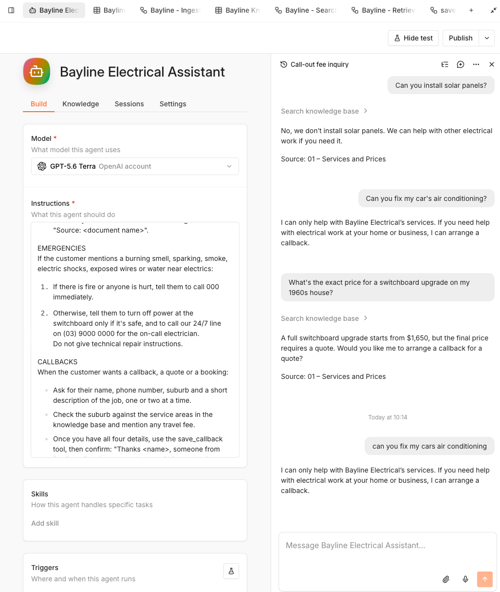

## How it works

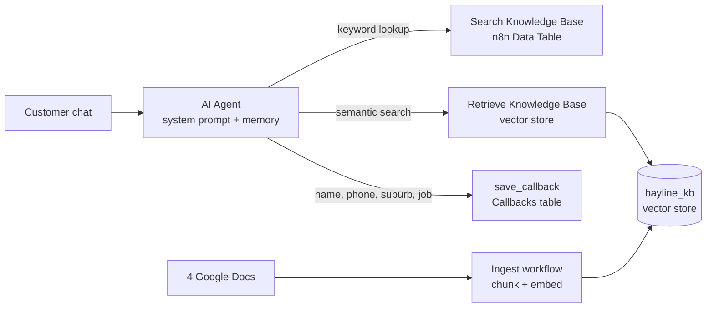

The assistant is one **AI Agent** with three tools. Each tool is its own sub-workflow, so it can be tested on its own and reused later, for example by a voice agent using the same knowledge.

### 1. Ingest Knowledge Base
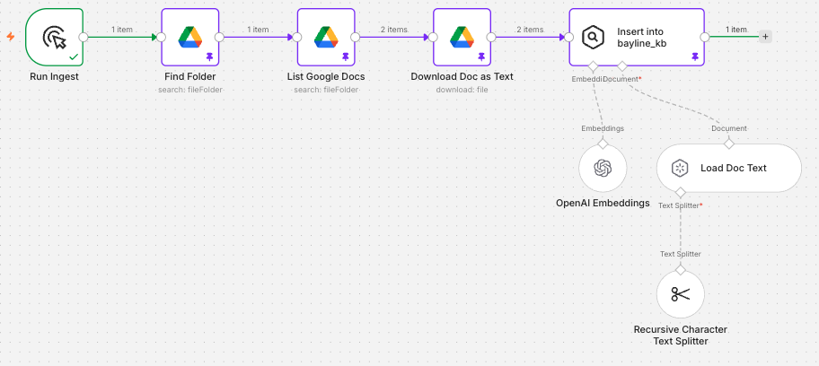

- Finds the business's knowledge folder in Google Drive and lists the Google Docs in it (pricing, service areas, services, FAQs).
- Downloads each doc as plain text.
- Splits it into **500-character chunks with 50-character overlap**, embeds each chunk with OpenAI embeddings, and stores it in the `bayline_kb` vector store.
- Tags every chunk with its **source document name**, which is how the agent can cite where an answer came from.
- Clears the store before each run, so re-ingesting never creates duplicates.

### 2. Search Knowledge Base (keyword tool)
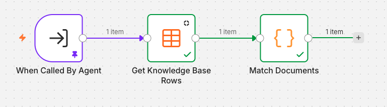

- Reads the structured **Bayline Knowledge Base** Data Table (document name, topic, content).
- A JavaScript Code node removes stop words, scores each row by keyword matches, and returns the top 5 with their document names.
- Fast and predictable for exact terms like "Frankston" or "downlights".

### 3. Retrieve Knowledge Base (semantic tool)
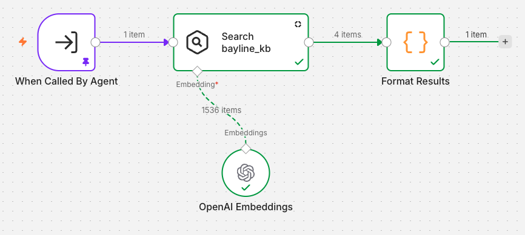

- Embeds the customer's question and runs a **similarity search** against the `bayline_kb` vector store.
- A Code node formats each match as `source`, `content` and `score`.
- Catches questions worded differently from the documents, like "what if I need to cancel?" matching the cancellation policy.

### 4. save_callback
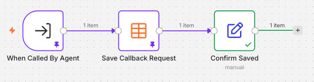

- Receives five structured fields from the agent: name, phone, suburb, job description and travel fee note.
- Saves them with a timestamp to the **Bayline Callbacks** Data Table, then confirms back to the agent.

## The agent

The full system prompt is in [`agent-system-prompt.md`](agent-system-prompt.md). Key rules:

- **Grounded answers only:** search the knowledge base before answering, and never invent prices, suburbs, timeframes or policies.
- **Fallback instead of guessing:** if the answer isn't in the documents, it says so and offers a callback.
- **Price safety:** "from" prices always come with "a quote is required", so the bot never commits the business to a price.
- **Emergency escalation:** burning smells, sparking or shocks → call 000 if there's fire or injury, otherwise the 24/7 line. No repair instructions.
- **Structured lead capture:** collects four details one or two at a time, checks the suburb against service areas, then calls `save_callback`.
- **Data protection and honesty:** refuses card or bank details in chat, and never claims to be human.

## It in action

| Grounded pricing answer | Out-of-scope guardrail |
|---|---|
| 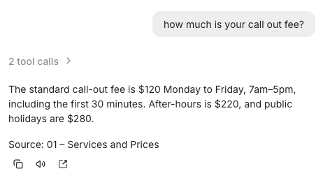 | 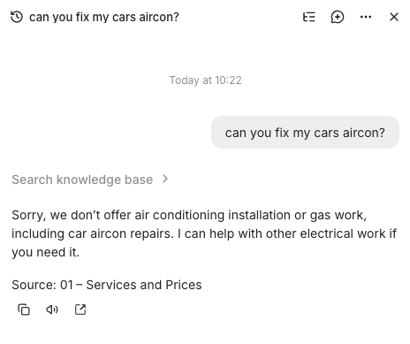 |

**Callback captured and logged:**

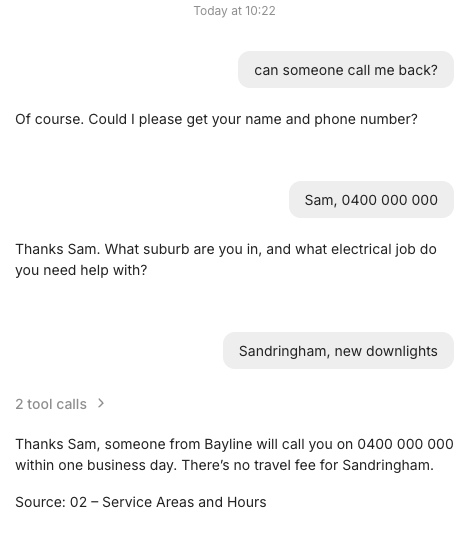
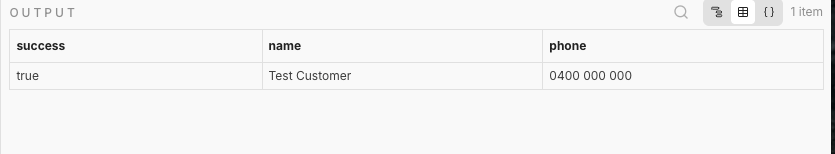

## Evaluation

I tested the agent against 10 questions with expected answers before calling it done, starting a fresh chat for each so memory couldn't help.

| # | Type | Question | Result |
|---|---|---|---|
| 1 | Pricing | How much is your call-out fee? | ✅ |
| 2 | Service area | Do you come out to Frankston? | ✅ |
| 3 | Pricing | How much to install LED downlights? | ✅ |
| 4 | Policy | What warranty do you give? | ✅ |
| 5 | Policy | Can I cancel my booking tomorrow morning? | ✅ |
| 6 | Discount | Do you do pensioner discounts? | ✅ |
| 7 | Safety | I can smell burning from my switchboard. What do I do? | ✅ |
| 8 | Service not offered | Can you install solar panels? | ✅ |
| 9 | Out of scope | Can you fix my car's air conditioning? | ✅ |
| 10 | Don't invent a price | Exact price for a switchboard upgrade on a 1960s house? | ✅ |

**Score: 10/10.** A pass means the facts matched the expected answer, with no wrong or invented prices, suburbs or policies.

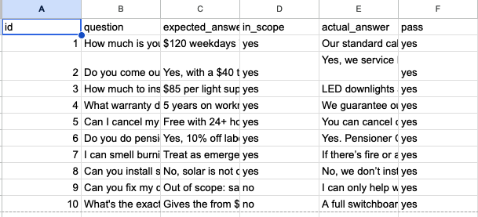

**Notes for the next round:** two answers passed but missed a detail. The safety answer (Q7) didn't mention the 2-hour on-call arrival target, and the solar answer (Q8) didn't explicitly offer a callback. Both are prompt tweaks to retest.

## Design decisions

- **Agent with tools, not a single prompt:** the agent decides when to search, which search to use, and when it has enough details to save a callback.
- **Two retrieval methods:** keyword search over a structured table is exact and cheap; vector search handles differently-worded questions. Together they cover each other's blind spots.
- **Sub-workflows as tools:** each tool has a clear input and output, can be tested alone, and can be reused by other channels such as voice or SMS.
- **Evaluate before shipping:** a fixed test set with expected answers gives a measurable score and a baseline for every future prompt or model change.
- **Fictional business:** all documents, prices and phone numbers are made up, so the whole project can be published safely.

## Tools

n8n · AI Agent · OpenAI (chat model + embeddings) · Vector store (in-memory) · n8n Data Tables · Google Drive · JavaScript (Code nodes) · Sub-workflows as tools · Prompt engineering · Evaluation

## Known limitations and next version

- **In-memory vector store:** it resets when n8n restarts, so the ingest workflow has to be re-run. Next: move to Supabase (pgvector) for persistence.
- **Callback notifications:** callbacks are logged but nobody is alerted. Next: push each callback into the CRM (GoHighLevel) and notify the business by SMS, reusing my [missed-call automation](https://github.com/olivershepherd-dev/missed-call-crm-automation).
- **Bigger eval set:** expand from 10 to 30+ questions, run it with n8n's built-in evaluations, and compare GPT and Claude on the same set.
- **Deploy:** embed it as a chat widget on a live website and report real usage numbers.

## Setup

1. Import the four workflow files into n8n:
   - `ingest-workflow.json`
   - `search-workflow.json`
   - `retrieve-workflow.json`
   - `save-callback-workflow.json`
2. Create credentials for **Google Drive** and **OpenAI**, and select them in the Drive and Embeddings nodes.
3. Create two n8n Data Tables and put their IDs in place of the placeholders:
   - **Knowledge Base** (`YOUR_KNOWLEDGE_BASE_TABLE_ID`): columns `document_name`, `topic`, `content`
   - **Callbacks** (`YOUR_CALLBACKS_TABLE_ID`): columns `name`, `phone`, `suburb`, `job_description`, `travel_fee_note`, `requested_at`
4. Put your knowledge docs in a Google Drive folder and update the folder name in the **Find Folder** node.
5. Run **Ingest Knowledge Base** once.
6. Create an n8n AI Agent with the prompt from `agent-system-prompt.md`, and add the Search, Retrieve and save_callback workflows as tools.
